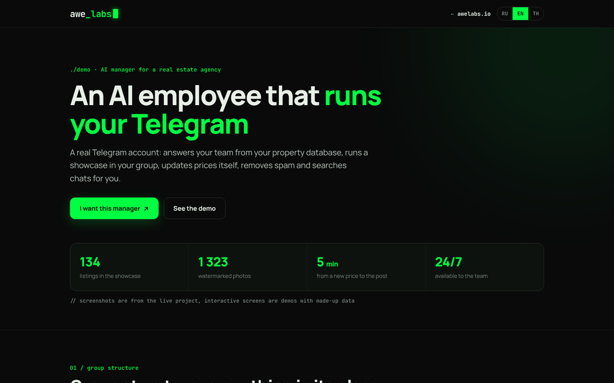

# AweLabs - AI manager for a real estate agency in Telegram (demo)

**Live demo:** https://awelabs.io/demo/realty/

[English](#english) · [Русский](#русский)

## English

A front-end demo of an AI employee that works from a **real Telegram account** of a real estate agency: answers the team from the property database, runs a listing showcase in the group and keeps it clean.

### What the real system does

- Helpdesk in private chat: properties, prices, bookings, free dates
- Takes tasks and reports when a staff member has done them
- Showcase group with 12 topics: 134 listings and 1,323 watermarked photos
- Price or status changed - the post updates within 5 minutes
- Daily listing post with AI-picked room photos
- Anti-spam: links, foreign accounts and bots removed, every action reported
- Searches classifieds groups and marketplaces, by text or photo
- Works with a CRM, Google Sheets or Excel

Stack: Python, Telethon, Claude API, SQLite, systemd.

### About the demo

A single static HTML page, no backend. Screenshots come from the live project with personal data masked, interactive screens run on made-up data. Languages: RU / EN / TH.

## Русский

Фронтенд-демо ИИ-сотрудника, который работает с **живого Telegram-аккаунта** агентства недвижимости: отвечает команде по базе объектов, ведёт витрину в группе и следит за порядком.

### Что делает настоящая система

- Справочная в личке: объекты, цены, брони, свободные даты
- Принимает задачи и отчитывается, когда сотрудник их выполнил
- Группа-витрина на 12 тем: 134 объявления и 1 323 фото с водяным знаком
- Сменилась цена или статус - пост обновляется за 5 минут
- Ежедневный пост с объектом и фото комнат, подобранными ИИ
- Антиспам: ссылки, иностранные аккаунты и боты удаляются, по каждому действию отчёт
- Ищет по группам объявлений и маркетплейсам, по тексту или фото
- Работает с CRM, Google Sheets или Excel

Стек: Python, Telethon, Claude API, SQLite, systemd.

### О демо

Одна статичная HTML-страница без бэкенда. Скриншоты из живого проекта, личные данные скрыты, интерактивные экраны - на вымышленных данных. Языки: RU / EN / TH.

---

**AweLabs** - automation studio · [awelabs.io](https://awelabs.io) · [Telegram](https://t.me/awe_labs)
